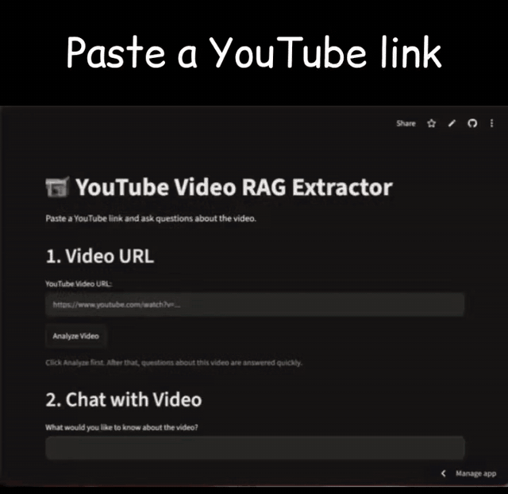

# AI Content Extractor

Ask questions about any public YouTube video.

**Live demo:** https://aryan-yt-analyzer-2026.streamlit.app



This repo has two independent parts:

| Part | What it does | Stack |
|---|---|---|
| **Streamlit demo** (`app/ui.py`, `app/vision_utils.py`) | Gemini watches and listens to the video, writes a timestamped description, and answers questions from it | Python, Streamlit, Gemini |
| **FastAPI service** (`app/main.py`, `app/pipeline.py`, `app/vector_db.py`) | Transcribes audio, indexes it in a vector database, and answers questions by retrieving the most similar chunks | FastAPI, yt-dlp, Whisper, Sentence-Transformers, Qdrant, Gemini |

---

## 1. Streamlit demo: Gemini video analysis

```
YouTube URL -> Gemini (10-minute chunks, analyzed in parallel)
            -> timestamped description: what is visible + what is spoken
            -> cached on disk

Question -> Gemini answers from the cached description (streamed)
```

1. **Analyze:** long videos are split into 10-minute chunks and described in parallel (up to 4 requests at a time). Each segment has a `[MM:SS]` timestamp, what is visible on screen, and what is spoken.
2. **Cache:** the description is saved to disk, so each video is analyzed once and follow-up questions are fast.
3. **Answer:** `ask_video` answers from the cached description and streams the response. Answers are always in English, even if the video is in Hindi.
4. **Reliability:** each request retries on 503/429 errors and falls back to a second Gemini model if the first one fails.

Note: this part does not use vector search. The whole description is passed to the model.

## 2. FastAPI service: transcript + vector search

```
YouTube URL -> yt-dlp (audio) -> Whisper (transcript) -> chunks
            -> Sentence-Transformers (embeddings) -> Qdrant

Question -> embed -> top-3 similar chunks -> Gemini (gemini-3.8-flash) -> answer
```

1. **Ingestion:** `yt-dlp` downloads the audio of a public video.
2. **Transcription:** Whisper transcribes the audio (processed as a NumPy array, so no system-level ffmpeg call is needed).
3. **Indexing:** the transcript is split into chunks (500 characters, 50 overlap, LangChain's `RecursiveCharacterTextSplitter`), embedded with `paraphrase-multilingual-MiniLM-L12-v2` (384 dimensions, cosine distance) and stored in Qdrant.
4. **Retrieval and answer:** the question is embedded, the top 3 chunks are retrieved, and Gemini answers using only those chunks. The response includes the source chunks.

### Endpoints

| Method | Path | Body | Description |
|---|---|---|---|
| GET | `/` | none | Health check |
| POST | `/process-video` | `{"url": "..."}` | Download, transcribe, chunk, embed and store a video |
| POST | `/search` | `{"query": "..."}` | Retrieve top chunks and generate an answer with sources |

---

## Setup

```bash
git clone https://github.com/kaseraaryan5-star/ai-content-extractor.git
cd ai-content-extractor
pip install -r requirements.txt
```

Create a `.env` file in the project root:

```
GOOGLE_API_KEY=your_key_here
```

Run the Streamlit demo:

```bash
streamlit run app/ui.py
```

Run the FastAPI service:

```bash
uvicorn app.main:app --reload
```

Or with Docker:

```bash
docker compose up --build
```

## Project structure

```
app/
  ui.py            Streamlit interface
  vision_utils.py  Gemini video analysis, caching, retries
  main.py          FastAPI endpoints
  pipeline.py      yt-dlp + Whisper + chunking
  vector_db.py     Qdrant storage and search
tests/
Dockerfile
docker-compose.yml
```

## Known limitations and next steps

- The Streamlit demo analyzes the whole video with Gemini, so the first analysis of a long video takes time.
- Answers do not show source timestamps yet.
- Next: add timestamps to retrieved chunks and answers, and a small evaluation (10-15 questions, check whether the right chunk is in the top 3) to compare chunk sizes.
